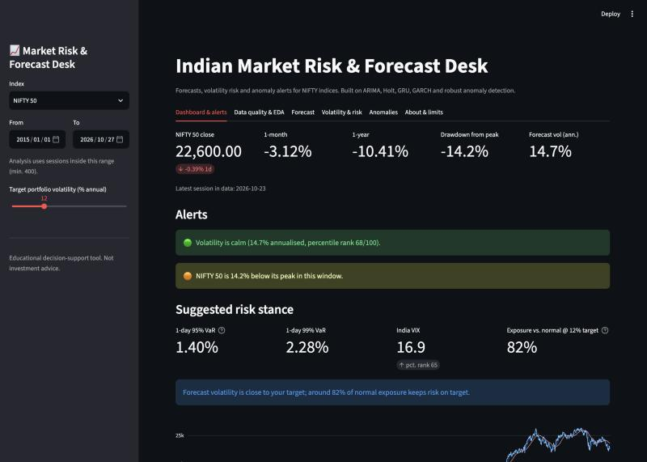
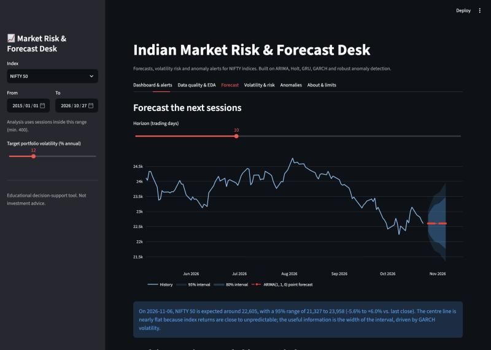
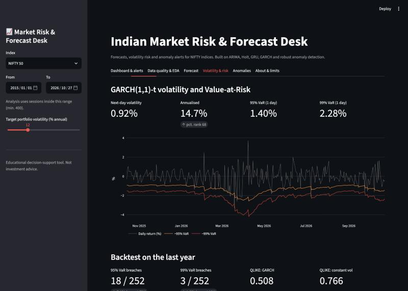
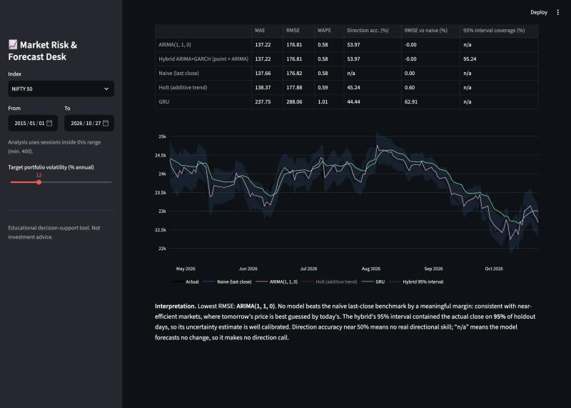
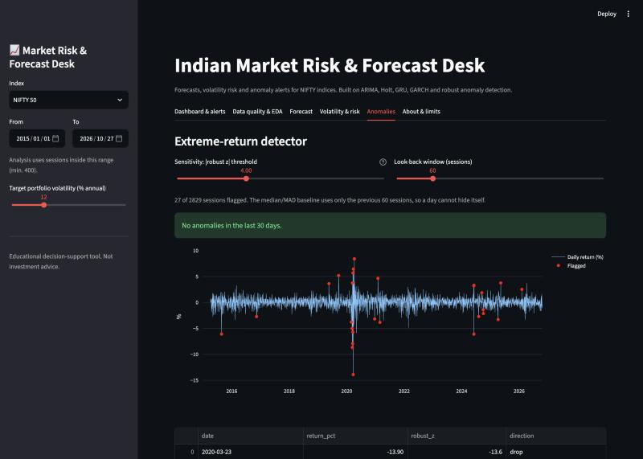

# Indian Market Risk & Forecast Desk

A risk dashboard for Indian equity indices (NIFTY 50, Bank, IT, Pharma, India VIX). It forecasts volatility and Value-at-Risk with GARCH,
benchmarks price forecasts (ARIMA, Holt, GRU, ARIMA+GARCH hybrid) against a naive baseline, and flags extreme-move anomalies. Built with a FastAPI backend and a Streamlit frontend.


[](LICENSE)



## Why

Index prices are close to a random walk, so "predict tomorrow's NIFTY" makes a poor product. Investors can act on three other questions:
*how risky is the market now, how wide is the plausible range, and is today's move unusual?* This app answers those with calibrated
uncertainty (volatility, VaR, prediction intervals) and anomaly alerts, and turns them into a volatility-targeted exposure suggestion.

## Key results

From the executed notebook ([`outputs/`](outputs/)) and the app. The full write-up is in [`docs/REPORT.md`](docs/REPORT.md).

**Price forecasts, NIFTY 50, last 252 sessions (2025-10-14 to 2026-10-23), one-step walk-forward:**

| Model | RMSE (points) | MAPE % |
|---|---|---|
| Naive (last close) | 206.3 | 0.644 |
| ARIMA(0,1,0) | 206.3 | 0.644 |
| Holt | 207.1 | 0.647 |
| RNN | 343.3 | 1.137 |
| GRU | 362.7 | 1.207 |
| LSTM | 1076.3 | 3.790 |

- **No model beats the naive benchmark.** The neural networks did clearly worse, which fits near-efficient markets.
  The useful output is the interval: the hybrid ARIMA+GARCH 95% prediction interval covered **95.2%** of actual closes.
- **Volatility:** GARCH(1,1)-t QLIKE of **0.508** beats a constant-volatility baseline (0.766). Persistence is α+β ≈ 0.98.
- **VaR backtest (252 days):** 95% VaR was breached 7.1% of days (5% expected) and 99% VaR 1.2% (1% expected).
- **Anomalies:** 30 extreme days at |robust z| ≥ 4 over 2011–2026. They are dominated by March 2020 and include 2015-08-24, 2024-06-04 and 2024-08-05.

| Forecast fan chart | Volatility & VaR |
|---|---|
|  |  |
| **Model comparison** | **Anomaly detection** |
|  |  |

## Methods

| Method | Role |
|---|---|
| Naive (last close) | Benchmark that any useful model must beat |
| ARIMA(p,1,q), AIC grid search | Classical model for non-stationary levels (ADF/KPSS-tested) |
| Holt additive trend | Exponential smoothing alternative |
| RNN / GRU / LSTM (30-day window) | Tests whether non-linear sequence models add value |
| Hybrid ARIMA + GARCH(1,1)-t | ARIMA mean with GARCH variance for calibrated intervals |
| GARCH(1,1)-t VaR | Handles volatility clustering and fat tails (excess kurtosis 19.4) |
| Rolling median/MAD robust z-score | Outlier-resistant anomaly detection using only past data |
| VAR (5 indices) | Cross-market dynamics (notebook) |

All evaluation is chronological. The test period is never used for model selection or scaling.

## Tech stack

**Analysis:** pandas, NumPy, SciPy, statsmodels, arch, scikit-learn, PyTorch · **App:** FastAPI, Uvicorn, Streamlit, Plotly · **Data:** Parquet via pyarrow

## Repository structure

```
├── backend/
│   ├── data.py        # download, cache and clean data; data-quality report
│   ├── analysis.py    # stationarity, STL, forecasting models, GARCH/VaR, anomalies
│   └── main.py        # FastAPI endpoints (/series /quality /eda /forecast /risk /anomalies /alerts)
├── frontend/app.py    # Streamlit dashboard (6 tabs)
├── notebooks/         # full analysis notebook (executed, outputs saved)
├── outputs/           # CSV tables exported by the notebook
├── docs/REPORT.md     # project report
├── screenshots/
├── run_backend.sh
└── run_frontend.sh
```

## Setup & run

Requires Python 3.10+ (tested on 3.13). The first run needs internet access to download the data.

```bash
git clone https://github.com/Vanshi05/TSDA-proj.git
cd TSDA-proj
python -m venv .venv
source .venv/bin/activate
python -m pip install -r requirements.txt
```

Start the backend (http://127.0.0.1:8000, interactive API docs at `/docs`):

```bash
./run_backend.sh
```

In a second terminal, start the frontend (http://localhost:8501):

```bash
./run_frontend.sh
```

Set `TSDA_API` if the backend runs on another host. To reproduce the analysis, open `notebooks/time_series_financial_pipeline.ipynb` in Jupyter and run all cells.

### Using the app

1. In the sidebar, pick an index, a date range and your target portfolio volatility.
2. **Dashboard & alerts**: headline metrics, alerts, VaR and a suggested exposure level.
3. **Data quality & EDA**: cleaning report, return distribution, ADF/KPSS, ACF, monthly heatmap, STL.
4. **Forecast**: a 1–30 day fan chart, plus the held-out model comparison.
5. **Volatility & risk**: GARCH-t volatility, 95/99% VaR and a one-year backtest.
6. **Anomalies**: an extreme-move detector with adjustable sensitivity and CSV download.

## Data

The data comes from public Parquet files in [aswinv90/indian-market-historical-data](https://github.com/aswinv90/indian-market-historical-data).
It covers daily closes from 2007 (Pharma from 2011) to the present. Files download on first use and are cached in `data_cache/`, which refreshes daily.

## Limitations

The app does not claim to predict prices. VaR slightly underestimates risk at 95% in turbulent periods, and the data covers close prices only with no transaction costs.
GJR-GARCH/EGARCH and filtered historical simulation are natural next steps. **Not investment advice.**

## Author

[Vanshi05](https://github.com/Vanshi05) · Licensed under the [MIT License](LICENSE).
